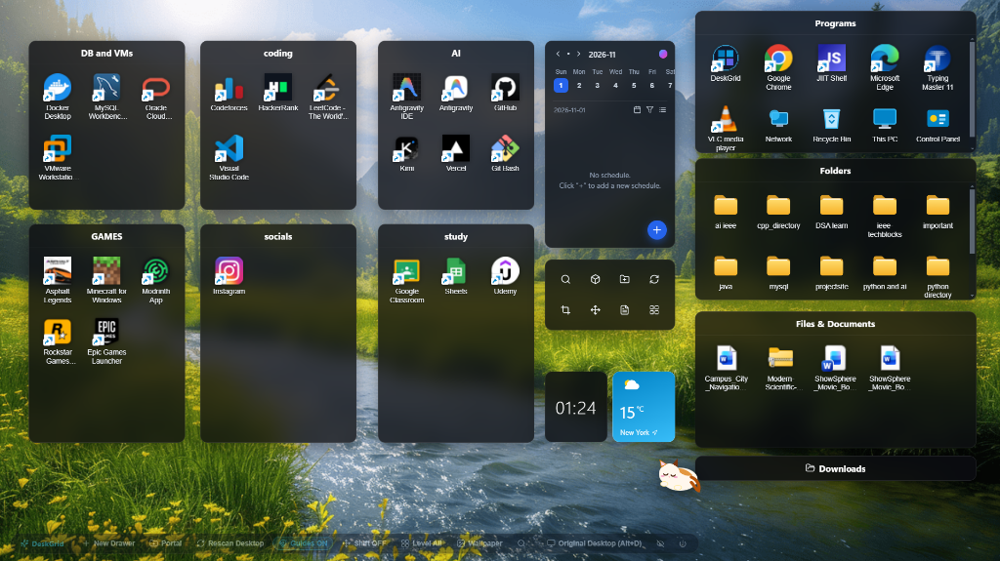
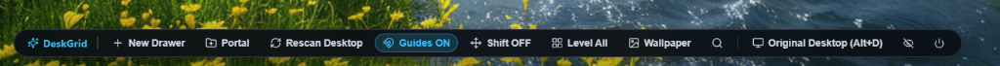
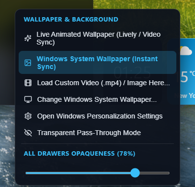

# DeskGrid — Modern Windows Desktop Overlay & Drawer Manager

<div align="center">

[](LICENSE)
[](https://microsoft.com/windows)
[](https://www.electronjs.org/)
[](https://react.dev/)
[](https://www.typescriptlang.org/)
[](https://github.com/pranav2020-pixel/DeskGrid/releases/tag/v1.0.5)

**A sleek, translucent Windows desktop overlay and drawer organizer inspired by *iTop Easy Desktop* and *Stardock Fences*.**  
Organize apps, shortcuts, documents, and folders into magnetic, customizable drawers with real-time alignment rulers and live wallpaper support.

<br />



*DeskGrid with translucent glass drawers, authentic Windows Shell icons, dynamic calendar, clock & weather widgets.*

</div>

---

## 🎛️ Floating Control Dock

<div align="center">
  
</div>

The bottom control dock provides 1-click access to all core actions:
- **`+ New Drawer`**: Create a new customizable drawer anywhere on your desktop.
- **`📁 Portal`**: Create an auto-refreshing folder portal (e.g., Downloads, Projects).
- **`🔄 Rescan Desktop`**: Non-destructively syncs newly created shortcuts while preserving all custom drawers and item positions.
- **`🧲 Guides ON / OFF`**: Toggle real-time magnetic snapping rulers and dimension guides.
- **`↔️ Shift ON / OFF`**: Toggle smooth drawer push mode to prevent overlapping.
- **`⊞ Level All`**: Auto-align and snap all desktop drawers to an 8px grid.
- **`🖼️ Wallpaper`**: Instant access to live wallpaper and opacity controls.
- **`🖥️ Original Desktop (Alt+D)`**: Instantly minimize DeskGrid and switch to standard Windows desktop view.

---

## 🎨 Smart Wallpaper & Background Engine

<div align="center">
  
  <p><em>Instant background synchronization & drawer opaqueness slider</em></p>
</div>

- **Active Lively Wallpaper Sync**: Automatically detects running [Lively Wallpaper](https://rocksdanister.github.io/lively/) video streams and hardware-accelerates playback at 60 FPS.
- **Instant Windows Wallpaper Sync**: Monitors Windows registry and theme events (`HKCU\Control Panel\Desktop\Wallpaper`) to sync instantly whenever you change your wallpaper.
- **Custom Video & Media Support**: Directly load custom `.mp4` video loops or high-resolution images as your desktop backdrop.
- **Transparent Pass-Through Mode**: Completely translucent background letting native video wallpapers pass through smoothly.
- **Global & Individual Opacity**: Adjust all drawer background opacities from 10% to 100% on the fly with real-time preview.

---

## ✨ Core Features

### 🗂️ Draggable, Namable & 8-Way Resizable Drawers
- **8-Direction Resizing**: Resize drawers from any edge or corner (`N, S, E, W, NE, NW, SE, SW`) with smooth boundary guards.
- **Inline Renaming**: Double-click any drawer header (or click the edit pencil) to rename it.
- **Roll-Up / Collapse Mode**: Collapse drawers into compact title pills to maximize screen real estate.
- **Authentic Windows Shell Icons**: Directly queries the live Windows Shell icon cache (`SHGetFileInfo`) to display authentic desktop icons for all applications, Electron apps, games, and shortcuts.
- **Non-Destructive Syncing**: Manually shifted items and custom user-created drawers are 100% preserved during desktop rescans and app restarts.

### 🧲 Real-Time Magnetic Guide & Level Lines
- **Multi-Point Snapping**: Snaps to sibling edges, centers, and screen workArea boundaries with live cyan and violet guide lines.
- **Equal-Spacing Rulers**: Live pixel distance badges (`12px`, `14px`, `16px`) indicate equidistant alignment between neighboring drawers.
- **Dimension Matching**: Visual indicator glows when a resized drawer matches the exact width or height of adjacent drawers.
- **Smooth Push/Shift Mode**: Toggle **Shift Mode** (or hold `Shift` while dragging) to push neighboring drawers out of the way smoothly without collisions.
- **Snap Bypass**: Hold `Alt` while dragging or resizing to bypass magnetic snapping freely.

### 🛡️ Non-Intrusive & Taskbar Safe
- **Strict WorkArea Bounding**: Clamped strictly above the Windows Taskbar (`screen.getPrimaryDisplay().workArea`). Your taskbar is never covered or overlapped.
- **Desktop Z-Order Pinning**: Stays pinned at `HWND_BOTTOM` behind all regular applications (browsers, IDEs, games) so they always stay on top.
- **System Tray Integration**: Runs cleanly in the Windows System Tray with instant toggle, rescan, and drawer management options.

### 📅 Built-In Desktop Widgets
- **Calendar & Schedule Planner**: Interactive weekly date picker and quick schedule list.
- **Quick Tools 2×4 Action Grid**: Fast shortcuts to Search, Add Drawer, Create Portal, Sync Desktop, Trigger Windows Snipping Tool, Auto-Shift, and Auto-Level.
- **Digital Clock & Live Weather Card**: Real-time clock and live temperature card (powered by Open-Meteo).

---

## 🚀 Download & Installation

### Option A: Standalone Windows Installer (.exe)
Download the latest pre-compiled installer from GitHub:
- **[DeskGrid Setup 1.0.5.exe](https://github.com/pranav2020-pixel/DeskGrid/releases/download/v1.0.5/DeskGrid.Setup.1.0.5.exe)** (Standalone Windows Installer)

### Option B: 1-Click Launch from Source (Windows)
Double-click **`Launch-DeskGrid.bat`** in the repository root. It will:
1. Automatically run `npm install` if dependencies are missing.
2. Build the production React frontend.
3. Create a `DeskGrid.lnk` shortcut on your Windows desktop with the custom high-res icon.
4. Launch DeskGrid immediately.

### Option C: Manual Build & Run

#### Prerequisites
- **Node.js** (v18 or higher) and **npm**
- **Windows 10 / 11**

#### Clone & Install
```bash
git clone https://github.com/pranav2020-pixel/DeskGrid.git
cd DeskGrid
npm install
```

#### Development Mode (Vite Hot-Reload + Electron)
```bash
npm run dev
```

#### Production Build & Run
```bash
npm start
```

#### Build Standalone Setup Installer
```bash
# Builds the NSIS setup installer into dist-installer/DeskGrid Setup 1.0.5.exe
npm run dist
```

---

## ⌨️ Shortcuts & Controls

| Shortcut / Control | Action |
| :--- | :--- |
| **`Alt + D`** | **Toggle DeskGrid / Switch to Original Windows Desktop** |
| **`Ctrl + F`** | Open Desktop Search modal across all drawers |
| **Double-Click Header** | Roll-up / Collapse drawer into sleek title pill |
| **Double-Click Title** | Rename drawer inline |
| **Double-Click Item** | Launch file, shortcut, or app via native Windows Shell |
| **Hold `Shift` (or Shift ON)** | Smoothly push / shift neighboring drawers while dragging |
| **Hold `Alt`** | Temporarily bypass magnetic guide & level line snapping |
| **Double-Click Empty Desktop** | Minimize DeskGrid to reveal original desktop |
| **Right-Click Empty Desktop** | Open desktop context menu (Add drawer, align, settings) |

---

## 🏗️ Architecture

```
DeskGrid/
├── assets/
│   ├── deskgrid.ico         # Application icon
│   ├── deskgrid.png         # High-resolution branding
│   └── screenshots/         # Documentation screenshots
│       ├── deskgrid-main.png
│       ├── wallpaper-menu.png
│       └── control-dock.png
├── electron/
│   ├── main.cjs             # Window lifecycle, HWND_BOTTOM z-order, wallpaper watcher, Shell API
│   └── preload.cjs          # Secure IPC contextBridge (deskgridAPI)
├── src/
│   ├── components/
│   │   ├── AlignmentGuides.tsx  # SVG magnetic guide lines, equal spacing rulers, dimension pills
│   │   ├── DesktopWidgets.tsx   # Calendar, Quick Tools, Clock, and Weather widgets
│   │   ├── DrawerBox.tsx        # 8-way resizable, draggable drawer container
│   │   └── RichItemIcon.tsx     # Vector icon renderer & native Windows thumbnail fallback
│   ├── engine/
│   │   └── alignmentEngine.ts   # Edge/center snap logic, gap calculations, overlap shifting
│   ├── data/
│   │   └── defaultLayout.ts     # Responsive layout generator & non-destructive rescan syncer
│   ├── types.ts                 # TypeScript data contracts & state interfaces
│   ├── App.tsx                  # Main canvas, state management, video background player
│   └── styles.css               # Modern glassmorphism & responsive drawer styles
├── Launch-DeskGrid.bat      # 1-Click launcher script for Windows
├── package.json             # Electron-builder scripts & dependencies
└── vite.config.ts           # Fast Vite build pipeline
```

---

## 🤝 Contributing

Contributions, issues, and feature requests are welcome!
1. Fork the Project
2. Create your Feature Branch (`git checkout -b feature/AmazingFeature`)
3. Commit your Changes (`git commit -m 'Add some AmazingFeature'`)
4. Push to the Branch (`git push origin feature/AmazingFeature`)
5. Open a Pull Request

---

## 📄 License

Distributed under the **MIT License**. See `LICENSE` for more information.
